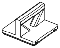

# Stakee

Parametric, stackable, 3D-printable storage for electronics hackers.

<p>
  
  
  
  
</p>

## What it is

Stakee is a set of crates on a 42 mm grid. Every crate is the lid of the crate below.

- **Stacking.** The bottom of each crate has Gridfinity-profile feet. The top has a stacking lip with 45° chamfers. The feet of an upper crate seat in the lip of the lower one.
- **Exact pitch.** A crate that is `h` height units tall stacks at exactly `7 × h` mm. Heights add up: put a 3-unit crate on a 6-unit crate and the next part seats 42 + 21 = 63 mm above the bottom of the stack.
- **Gridfinity baseplates.** The feet use the Gridfinity foot profile, so crates also sit on Gridfinity baseplates.
- **One contract.** Every part is generated in Python ([build123d](https://github.com/gumyr/build123d)) from the same geometry module, [`stakee/core.py`](stakee/core.py). Each crate has magnet pockets, divider slots every 21 mm, clip sockets and (from 3 units tall) a front label recess.
- **Ready files and a generator.** The [`models/`](models/README.md) folder holds ready STL, STEP and preview files. The `stakee` CLI makes any crate size from 1×1×2 to 8×8×40 units, with dividers, a label tile and a cap.

## Models

| Family | What it is |
| --- | --- |
| [Crates](models/crates/README.md) | Stackable crates and caps from 1x1 to 3x2 grid units: the base every other part fits. |
| [Dividers](models/dividers/README.md) | Interlocking X/Y rails, hook-on plates and bridges that split a crate; all print flat. |
| [Inserts](models/inserts/README.md) | Drop-in trays that turn a crate into a kit: dev-board dock, solder station, parts grid. |
| [Bag Library](models/baglib/README.md) | A tall crate that files distributor zip bags upright like a card index, with tab cards. |
| [Drawer cabinet](models/drawers/README.md) | Stackable sleeves with an open front and the drawers that slide into them. |
| [Pocket box](models/pocket/README.md) | A small hinged, latched box to carry around that still stacks like a crate. |
| [Carry kit](models/kit/README.md) | Stack clip, tote handle cap, NFC label cap and tool-rack cap for a grab-and-go stack. |
| [Magnetic tray](models/magtray/README.md) | A stackable screw tray with hidden magnets and one numbered compartment per step. |
| [ESD crates](models/esd/README.md) | Crates with a ground point (banana socket or snap stud) for dissipative filament. |
| [Wire dispenser](models/wirespool/README.md) | A crate with a lift-out axle and one eyelet per spool for hookup wire. |
| [Wall rail](models/wallrail/README.md) | A French cleat and shelves that hang crates on the wall above the bench. |
| [Calibration](models/calibration/README.md) | Small test prints that pick the lip clearance and divider fit for your printer. |

The full catalogue with previews and part counts is in [`models/README.md`](models/README.md).

## Quick start

Install [uv](https://docs.astral.sh/uv/getting-started/installation/), then:

```bash
git clone https://github.com/micovi/stakee.git
cd stakee
uv sync
```

Generate a 2×2×6 crate with four compartments, a press-fit `ESP32` label tile and a cap:

```bash
uv run stakee box 2x2x6 --dividers 2x2 --label ESP32 --cap
```

The STL and STEP files go to `./out/box-2x2x6-d2x2-esp32/`. List the sizes and options:

```bash
uv run stakee list
```

Rebuild the whole model library in `models/`:

```bash
uv run stakee-build
```

Print the [calibration](models/calibration/README.md) coupons before your first crate. See [Getting started](docs/getting-started.md).

## Repository layout

```text
stakee/
  core.py         geometry contract: grid, feet, lip, magnets, slots, sockets, label
  cli.py          the `stakee` command
  build.py        the `stakee-build` command
  families.py     the model families, in catalogue order
  export.py       STL/STEP/SVG export and manifest.json
  preview.py      SVG line-art previews
  docs.py         generates the README pages under models/
  modules/        one generator module per family
models/           generated output, committed: <family>/{stl,step,preview}/, manifest.json, README.md
docs/             hand-written documentation
site/             docs site (Astro + Starlight), deployed to GitHub Pages
tests/            pytest suite
```

## Documentation

- [Getting started](docs/getting-started.md): install, first prints, where files go.
- [CLI reference](docs/cli.md): every `stakee` command and option.
- [The system](docs/system.md): grid, height units, feet, lip, magnets, slots, label, sockets.
- [Printing](docs/printing.md): materials, calibration, magnets, ESD.
- [Building the library](docs/build.md): `stakee-build`, manifests, tests and lint.
- [Adding a family](docs/adding-a-family.md): write a new generator module.

Docs site: <https://micovi.github.io/stakee/>

## Contributing

See [CONTRIBUTING.md](CONTRIBUTING.md).

## License

No license has been chosen yet.
