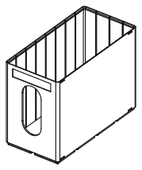

<!-- Generated by `uv run stakee-build`. Edit the generator, not this file. -->

# Models

Every family below is generated from the same geometry contract ([`stakee/core.py`](../stakee/core.py)): any part stacks on any crate of the same footprint. Open a family for its parts, sizes, print notes and STL/STEP files.

| Preview | Family | What it is | Parts |
| --- | --- | --- | --- |
|  | [**Crates**](crates/README.md) | Stackable crates and caps from 1x1 to 3x2 grid units: the base every other part fits. | 9 |
|  | [**Dividers**](dividers/README.md) | Interlocking X/Y rails, hook-on plates and bridges that split a crate; all print flat. | 18 |
|  | [**Inserts**](inserts/README.md) | Drop-in trays that turn a crate into a kit: dev-board dock, solder station, parts grid. | 3 |
|  | [**Bag Library**](baglib/README.md) | A tall crate that files distributor zip bags upright like a card index, with tab cards. | 22 |
|  | [**Drawer cabinet**](drawers/README.md) | Stackable sleeves with an open front and the drawers that slide into them. | 8 |
|  | [**Pocket box**](pocket/README.md) | A small hinged, latched box to carry around that still stacks like a crate. | 6 |
|  | [**Carry kit**](kit/README.md) | Stack clip, tote handle cap, NFC label cap and tool-rack cap for a grab-and-go stack. | 6 |
|  | [**Magnetic tray**](magtray/README.md) | A stackable screw tray with hidden magnets and one numbered compartment per step. | 2 |
|  | [**ESD crates**](esd/README.md) | Crates with a ground point (banana socket or snap stud) for dissipative filament. | 3 |
|  | [**Wire dispenser**](wirespool/README.md) | A crate with a lift-out axle and one eyelet per spool for hookup wire. | 4 |
|  | [**Wall rail**](wallrail/README.md) | A French cleat and shelves that hang crates on the wall above the bench. | 6 |
|  | [**Calibration**](calibration/README.md) | Small test prints that pick the lip clearance and divider fit for your printer. | 6 |
