<!-- Generated by `uv run stakee-build`. Edit the generator, not this file. -->

# Bag Library

A tall crate that files distributor zip bags upright like a card index, with tab cards.

[All models](../README.md) · 22 parts · rebuild with `uv run stakee-build --only baglib` · source: [`stakee/modules/baglib.py`](../../stakee/modules/baglib.py)

## Parts

| Preview | Part | Size (mm) | Material | Download |
| --- | --- | --- | --- | --- |
|  | **Bag Library crate 2x4x17** Files 70x100 mm component bags upright like a card index (cavity 80x164x114 mm, still cappable and stackable). Thumb window in front, index cards key into the side-wall slots. | 83.5 × 167.5 × 123 | PETG (PETG-ESD if you also keep unbagged ICs in it) | [STL](stl/crate-2x4x17.stl) · [STEP](step/crate-2x4x17.step) |
| 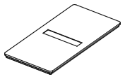 | **Cap 2x4** Lid for the Bag Library crate; seats in the stacking lip, label on top. | 83.5 × 167.5 × 7.2 | PETG | [STL](stl/cap-2x4.stl) · [STEP](step/cap-2x4.step) |
|  | **Index card RES (2-wide)** Divider card with an embossed RES tab; drops into any side-wall slot of the 2x4x17 crate. Tabs are staggered across 3 positions. | 80.7 × 112.9 × 1.6 | PLA or PETG (contrasting colour swap at the text layer) | [STL](stl/card-2x-res.stl) · [STEP](step/card-2x-res.step) |
| 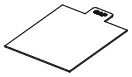 | **Index card CAP (2-wide)** Divider card with an embossed CAP tab; drops into any side-wall slot of the 2x4x17 crate. Tabs are staggered across 3 positions. | 80.7 × 112.9 × 1.6 | PLA or PETG (contrasting colour swap at the text layer) | [STL](stl/card-2x-cap.stl) · [STEP](step/card-2x-cap.step) |
|  | **Index card IC (2-wide)** Divider card with an embossed IC tab; drops into any side-wall slot of the 2x4x17 crate. Tabs are staggered across 3 positions. | 80.7 × 112.9 × 1.6 | PLA or PETG (contrasting colour swap at the text layer) | [STL](stl/card-2x-ic.stl) · [STEP](step/card-2x-ic.step) |
| 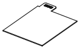 | **Index card MCU (2-wide)** Divider card with an embossed MCU tab; drops into any side-wall slot of the 2x4x17 crate. Tabs are staggered across 3 positions. | 80.7 × 112.9 × 1.6 | PLA or PETG (contrasting colour swap at the text layer) | [STL](stl/card-2x-mcu.stl) · [STEP](step/card-2x-mcu.step) |
| 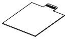 | **Index card CONN (2-wide)** Divider card with an embossed CONN tab; drops into any side-wall slot of the 2x4x17 crate. Tabs are staggered across 3 positions. | 80.7 × 112.9 × 1.6 | PLA or PETG (contrasting colour swap at the text layer) | [STL](stl/card-2x-conn.stl) · [STEP](step/card-2x-conn.step) |
|  | **Index card LED (2-wide)** Divider card with an embossed LED tab; drops into any side-wall slot of the 2x4x17 crate. Tabs are staggered across 3 positions. | 80.7 × 112.9 × 1.6 | PLA or PETG (contrasting colour swap at the text layer) | [STL](stl/card-2x-led.stl) · [STEP](step/card-2x-led.step) |
| 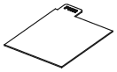 | **Index card PWR (2-wide)** Divider card with an embossed PWR tab; drops into any side-wall slot of the 2x4x17 crate. Tabs are staggered across 3 positions. | 80.7 × 112.9 × 1.6 | PLA or PETG (contrasting colour swap at the text layer) | [STL](stl/card-2x-pwr.stl) · [STEP](step/card-2x-pwr.step) |
| 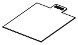 | **Index card MISC (2-wide)** Divider card with an embossed MISC tab; drops into any side-wall slot of the 2x4x17 crate. Tabs are staggered across 3 positions. | 80.7 × 112.9 × 1.6 | PLA or PETG (contrasting colour swap at the text layer) | [STL](stl/card-2x-misc.stl) · [STEP](step/card-2x-misc.step) |
| 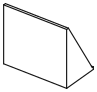 | **Bag follower (2-wide)** Ribbed wedge that slides behind the last bag so a half-empty row stays upright; lift it out by the top of the front plate. | 78.5 × 45 × 70 | PETG | [STL](stl/follower-2x.stl) · [STEP](step/follower-2x.step) |
|  | **Bag Library crate 4x3x17** Files 150x100 mm component bags upright like a card index (cavity 164x122x114 mm, still cappable and stackable). Thumb window in front, index cards key into the side-wall slots. | 167.5 × 125.5 × 123 | PETG (PETG-ESD if you also keep unbagged ICs in it) | [STL](stl/crate-4x3x17.stl) · [STEP](step/crate-4x3x17.step) |
| 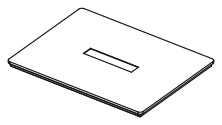 | **Cap 4x3** Lid for the Bag Library crate; seats in the stacking lip, label on top. | 167.5 × 125.5 × 7.2 | PETG | [STL](stl/cap-4x3.stl) · [STEP](step/cap-4x3.step) |
|  | **Index card RES (4-wide)** Divider card with an embossed RES tab; drops into any side-wall slot of the 4x3x17 crate. Tabs are staggered across 5 positions. | 164.7 × 112.9 × 1.6 | PLA or PETG (contrasting colour swap at the text layer) | [STL](stl/card-4x-res.stl) · [STEP](step/card-4x-res.step) |
| 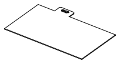 | **Index card CAP (4-wide)** Divider card with an embossed CAP tab; drops into any side-wall slot of the 4x3x17 crate. Tabs are staggered across 5 positions. | 164.7 × 112.9 × 1.6 | PLA or PETG (contrasting colour swap at the text layer) | [STL](stl/card-4x-cap.stl) · [STEP](step/card-4x-cap.step) |
| 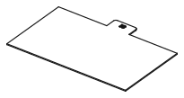 | **Index card IC (4-wide)** Divider card with an embossed IC tab; drops into any side-wall slot of the 4x3x17 crate. Tabs are staggered across 5 positions. | 164.7 × 112.9 × 1.6 | PLA or PETG (contrasting colour swap at the text layer) | [STL](stl/card-4x-ic.stl) · [STEP](step/card-4x-ic.step) |
| 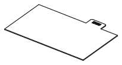 | **Index card MCU (4-wide)** Divider card with an embossed MCU tab; drops into any side-wall slot of the 4x3x17 crate. Tabs are staggered across 5 positions. | 164.7 × 112.9 × 1.6 | PLA or PETG (contrasting colour swap at the text layer) | [STL](stl/card-4x-mcu.stl) · [STEP](step/card-4x-mcu.step) |
| 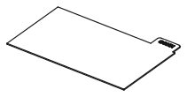 | **Index card CONN (4-wide)** Divider card with an embossed CONN tab; drops into any side-wall slot of the 4x3x17 crate. Tabs are staggered across 5 positions. | 164.7 × 112.9 × 1.6 | PLA or PETG (contrasting colour swap at the text layer) | [STL](stl/card-4x-conn.stl) · [STEP](step/card-4x-conn.step) |
| 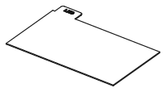 | **Index card LED (4-wide)** Divider card with an embossed LED tab; drops into any side-wall slot of the 4x3x17 crate. Tabs are staggered across 5 positions. | 164.7 × 112.9 × 1.6 | PLA or PETG (contrasting colour swap at the text layer) | [STL](stl/card-4x-led.stl) · [STEP](step/card-4x-led.step) |
|  | **Index card PWR (4-wide)** Divider card with an embossed PWR tab; drops into any side-wall slot of the 4x3x17 crate. Tabs are staggered across 5 positions. | 164.7 × 112.9 × 1.6 | PLA or PETG (contrasting colour swap at the text layer) | [STL](stl/card-4x-pwr.stl) · [STEP](step/card-4x-pwr.step) |
| 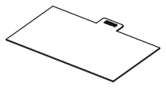 | **Index card MISC (4-wide)** Divider card with an embossed MISC tab; drops into any side-wall slot of the 4x3x17 crate. Tabs are staggered across 5 positions. | 164.7 × 112.9 × 1.6 | PLA or PETG (contrasting colour swap at the text layer) | [STL](stl/card-4x-misc.stl) · [STEP](step/card-4x-misc.step) |
| 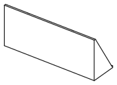 | **Bag follower (4-wide)** Ribbed wedge that slides behind the last bag so a half-empty row stays upright; lift it out by the top of the front plate. | 162.5 × 45 × 70 | PETG | [STL](stl/follower-4x.stl) · [STEP](step/follower-4x.step) |

## Print notes

- **Bag Library crate 2x4x17, Bag Library crate 4x3x17**: Upright, no supports (window arch bridges fine), 3 walls, 15% infill. Optional 6x2 mm magnets.
- **Cap 2x4, Cap 4x3**: Upside down (plate on the bed), no supports.
- **Index card RES (2-wide), Index card CAP (2-wide), Index card IC (2-wide), Index card MCU (2-wide), Index card CONN (2-wide), Index card LED (2-wide), Index card PWR (2-wide), Index card MISC (2-wide), Index card RES (4-wide), Index card CAP (4-wide), Index card IC (4-wide), Index card MCU (4-wide), Index card CONN (4-wide), Index card LED (4-wide), Index card PWR (4-wide), Index card MISC (4-wide)**: Flat, text up, no supports, 100% infill. Pause/colour change at 1.2 mm makes the text pop.
- **Bag follower (2-wide), Bag follower (4-wide)**: As modelled (base plate on the bed), no supports, 20% infill. Drop a few washers between the ribs if it needs more weight.

## How it works

Bag Library: file distributor zip bags upright like a card index, labels facing up and out.

A tall crate sized from `BoxSize.cavity` so a bag stands on its short edge and still clears
a cap, a thumb window in the front wall below the label/seat band, slot-keyed index cards with
staggered embossed tabs, and a sliding follower that props up a half-empty row.
