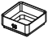
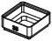

<!-- Generated by `uv run stakee-build`. Edit the generator, not this file. -->

# Calibration

Small test prints that pick the lip clearance and divider fit for your printer.

[All models](../README.md) · 6 parts · rebuild with `uv run stakee-build --only calibration` · source: [`stakee/modules/calibration.py`](../../stakee/modules/calibration.py)

## Parts

| Preview | Part | Size (mm) | Material | Download |
| --- | --- | --- | --- | --- |
|  | **Lip coupon 0.15 mm** Stacking lip cut with 0.15 mm clearance (marked 15). Set the probe on each coupon: pick the tightest one the probe drops into by its own weight and that does not rattle when you shake the pair, and use it as LIP_CLEARANCE in core.py (now 0.25). If even the loosest binds, fix elephant foot first; if the tightest rattles, rerun with smaller values (0.15 mm is the floor). | 41.5 × 41.5 × 18 | The filament you will print the crates in | [STL](stl/lip-coupon-15.stl) · [STEP](step/lip-coupon-15.step) |
|  | **Lip coupon 0.25 mm** Stacking lip cut with 0.25 mm clearance (marked 25). Set the probe on each coupon: pick the tightest one the probe drops into by its own weight and that does not rattle when you shake the pair, and use it as LIP_CLEARANCE in core.py (now 0.25). If even the loosest binds, fix elephant foot first; if the tightest rattles, rerun with smaller values (0.15 mm is the floor). | 41.5 × 41.5 × 18 | The filament you will print the crates in | [STL](stl/lip-coupon-25.stl) · [STEP](step/lip-coupon-25.step) |
|  | **Lip coupon 0.35 mm** Stacking lip cut with 0.35 mm clearance (marked 35). Set the probe on each coupon: pick the tightest one the probe drops into by its own weight and that does not rattle when you shake the pair, and use it as LIP_CLEARANCE in core.py (now 0.25). If even the loosest binds, fix elephant foot first; if the tightest rattles, rerun with smaller values (0.15 mm is the floor). | 41.5 × 41.5 × 18 | The filament you will print the crates in | [STL](stl/lip-coupon-35.stl) · [STEP](step/lip-coupon-35.step) |
|  | **Lip probe 1x1x2** A plain default 1x1x2 crate whose feet are the gauge for the lip coupons. Lower it onto each coupon by hand, then let go: it should drop the last few mm on its own and come to rest flat, with a 0.75 mm shadow gap all round. | 41.5 × 41.5 × 18 | The filament you will print the crates in | [STL](stl/lip-probe.stl) · [STEP](step/lip-probe.step) |
|  | **Divider slot strip** Two 1.6 x 0.8 mm divider slots exactly as in every crate, one in an X wall and one in a Y wall (printers often differ between axes). Use it with the slot sample comb. | 22 × 22 × 14 | The filament you will print the crates in | [STL](stl/slot-strip.stl) · [STEP](step/slot-strip.step) |
|  | **Divider end samples** Divider ends 1.2 / 1.4 / 1.5 / 1.55 mm thick. Press each finger's tip edge into both slots of the strip: the 1.2 mm plate must slide freely (if not, your slots print narrow). Pick the thickest end that goes in by hand in both slots and stays put when you turn the strip upside down; set END_THICKNESS in stakee/modules/dividers.py to it (now 1.5). | 48 × 20 × 2.4 | The filament you will print the dividers in | [STL](stl/slot-samples.stl) · [STEP](step/slot-samples.step) |

## Print notes

- **Lip coupon 0.15 mm, Lip coupon 0.25 mm, Lip coupon 0.35 mm**: Upright, no supports, same nozzle, layer height and elephant-foot compensation as the real crates; 2 walls, 15% infill. About 8.2 cm³.
- **Lip probe 1x1x2**: Upright, no supports, exactly the settings of your real crates (the feet are what is tested), 2 walls, 15% infill. About 11.3 cm³; keeps working as a crate.
- **Divider slot strip**: Floor on the bed, no supports, same settings as the crates. About 1.9 cm³.
- **Divider end samples**: Flat, labels up, no supports, 100% infill, same layer height as the dividers: at 0.2 mm layers the slicer rounds 1.5 and 1.55 to whole layers, use 0.1 mm or less to see the difference. About 1.5 cm³.

## How it works

Calibration coupons: a small, cheap test print that picks the tolerances for YOUR printer.

Parts:
- Lip coupons: 1x1x2 boxes (the shortest box the system allows), one per value in
  CLEARANCES, with the clearance in hundredths of a mm debossed on the front ("25" = 0.25).
  Every optional box feature is off and the floor has a window, to save filament and time.
- Probe: a plain default 1x1x2 box; its feet are the gauge tried in every coupon.
- Slot strip: an L of crate wall with a core divider slot in an X wall and in a Y wall.
- Slot samples: a comb of divider ends (the 1.2 mm plate, then the thick-end candidates)
  printed flat like the real dividers, each finger labelled with its thickness.

Lower limit: a foot's vertical face sits 2.15 mm in from the cell outline and the wall is
2.0 mm thick, so below 0.15 mm of lip clearance the cavity wall, not the lip, sets the play.

Rerun with other values: `uv run python -m stakee.modules.calibration --clearances 0.2 0.3`.
