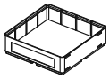
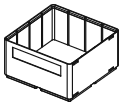
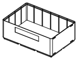
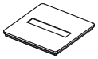
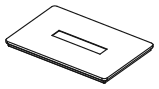

<!-- Generated by `uv run stakee-build`. Edit the generator, not this file. -->

# Crates

Stackable crates and caps from 1x1 to 3x2 grid units: the base every other part fits.

[All models](../README.md) · 9 parts · rebuild with `uv run stakee-build --only crates` · source: [`stakee/modules/crates.py`](../../stakee/modules/crates.py)

## Parts

| Preview | Part | Size (mm) | Material | Download |
| --- | --- | --- | --- | --- |
|  | **Crate 1x1x3** Stackable crate, usable cavity 38x38x16 mm. Divider slots every 21 mm, front label recess, clip sockets on the sides. | 41.5 × 41.5 × 25 | PLA or PETG | [STL](stl/crate-1x1x3.stl) · [STEP](step/crate-1x1x3.step) |
|  | **Crate 2x1x3** Stackable crate, usable cavity 80x38x16 mm. Divider slots every 21 mm, front label recess, clip sockets on the sides. | 83.5 × 41.5 × 25 | PLA or PETG | [STL](stl/crate-2x1x3.stl) · [STEP](step/crate-2x1x3.step) |
|  | **Crate 2x2x3** Stackable crate, usable cavity 80x80x16 mm. Divider slots every 21 mm, front label recess, clip sockets on the sides. | 83.5 × 83.5 × 25 | PLA or PETG | [STL](stl/crate-2x2x3.stl) · [STEP](step/crate-2x2x3.step) |
|  | **Crate 2x2x6** Stackable crate, usable cavity 80x80x36 mm. Divider slots every 21 mm, front label recess, clip sockets on the sides. | 83.5 × 83.5 × 46 | PLA or PETG | [STL](stl/crate-2x2x6.stl) · [STEP](step/crate-2x2x6.step) |
|  | **Crate 3x2x6** Stackable crate, usable cavity 122x80x36 mm. Divider slots every 21 mm, front label recess, clip sockets on the sides. | 125.5 × 83.5 × 46 | PLA or PETG | [STL](stl/crate-3x2x6.stl) · [STEP](step/crate-3x2x6.step) |
|  | **Cap 1x1** Lid that seats into any crate's stacking lip; recessed label on top. | 41.5 × 41.5 × 7.2 | PETG | [STL](stl/cap-1x1.stl) · [STEP](step/cap-1x1.step) |
|  | **Cap 2x1** Lid that seats into any crate's stacking lip; recessed label on top. | 83.5 × 41.5 × 7.2 | PETG | [STL](stl/cap-2x1.stl) · [STEP](step/cap-2x1.step) |
|  | **Cap 2x2** Lid that seats into any crate's stacking lip; recessed label on top. | 83.5 × 83.5 × 7.2 | PETG | [STL](stl/cap-2x2.stl) · [STEP](step/cap-2x2.step) |
|  | **Cap 3x2** Lid that seats into any crate's stacking lip; recessed label on top. | 125.5 × 83.5 × 7.2 | PETG | [STL](stl/cap-3x2.stl) · [STEP](step/cap-3x2.step) |

## Print notes

- **Crate 1x1x3, Crate 2x1x3, Crate 2x2x3, Crate 2x2x6, Crate 3x2x6**: Upright, no supports, 3 walls, 15% infill. Optional 6x2 mm magnets.
- **Cap 1x1, Cap 2x1, Cap 2x2, Cap 3x2**: Upside down (plate on the bed), no supports.

## How it works

The base range: plain stackable crates and caps in the sizes people actually print.

Exported sizes: crates 1x1x3, 2x1x3, 2x2x3, 2x2x6 and 3x2x6; caps 1x1, 2x1, 2x2 and 3x2.
Any other size from 1x1x2 to 8x8x40 comes from the CLI, e.g. `uv run stakee box 4x2x6`.

Size: a crate of `nx x ny x h` units is `42 * n - 0.5` mm per side and `7 * h + 4` mm
tall to the top of its stacking lip. The usable cavity is `42 * n - 4.5` mm per side and
`7 * h - 5.5` mm deep, measured from the floor to the stacking seat.

Stacking: the Gridfinity-profile feet of an upper crate drop into the lip of the crate below
and seat on its 45 deg chamfers, so the upper crate stands at exactly `z = 7 * h` of the
lower one, with a 0.75 mm shadow gap between the bodies. `verify()` checks this for every
exported size: a box and a cap placed at `7 * h` overlap the crate by zero volume, and
collide with it when lowered 0.05 mm (they seat on the chamfers, they do not hover).

Caps (`make_cap`): one hollow foot plus a 2.4 mm top plate, 7.15 mm tall. A cap seats in
the lip of any crate with the same footprint. Its top is flat, so it ends the stack.

Features of every crate (all from `make_box` in `stakee/core.py`):

- Magnet pockets: four per grid cell under the feet, 6.5 mm wide and 2.4 mm deep, 13 mm
  from the cell center on both axes, for optional 6x2 mm disc magnets.
- Divider slots: 1.6 mm wide and 0.8 mm deep, every 21 mm on all four inner walls. They run
  from the floor up through the lip, so a plate drops straight in. They take the 1.2 mm
  plates and 1.5 mm thick ends of the `dividers` family.
- Label recess: on the front (-Y) face, `min(width - 16, 60)` mm wide, 12 mm tall and
  0.6 mm deep, its top 1.5 mm below the stacking seat. Crates under 3 units tall have none.
  Caps carry the same recess on top.
- Clip sockets: eight L-shaped bayonet pockets on the side (+/-X) faces, 12 mm in from the
  front and back faces. Each side has two centered 2 mm below the lip top and two centered
  6.5 mm above the bottom. The `kit` stack clip locks two stacked crates together through them.
