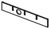
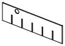

<!-- Generated by `uv run stakee-build`. Edit the generator, not this file. -->

# Dividers

Interlocking X/Y rails, hook-on plates and bridges that split a crate; all print flat.

[All models](../README.md) · 18 parts · rebuild with `uv run stakee-build --only dividers` · source: [`stakee/modules/dividers.py`](../../stakee/modules/dividers.py)

## Parts

| Preview | Part | Size (mm) | Material | Download |
| --- | --- | --- | --- | --- |
|  | **X rail 2x2x3** Full-width, 13.5 mm tall, notched from below; hook plates hang on it. | 80.7 × 1.5 × 13.5 | PLA (rails) · PETG (hook plates and bridges, the hooks flex better) | [STL](stl/rail-x-2x2x3.stl) · [STEP](step/rail-x-2x2x3.step) |
|  | **Y rail 2x2x3** Full-depth rail notched from the top: goes in first, X rails drop over it. | 80.7 × 1.5 × 13.5 | PLA (rails) · PETG (hook plates and bridges, the hooks flex better) | [STL](stl/rail-y-2x2x3.stl) · [STEP](step/rail-y-2x2x3.step) |
|  | **Hook plate 21 mm 2x2x3** From a front/back wall slot to an X rail 18.8 mm away. | 21.3 × 1.5 × 14.7 | PLA (rails) · PETG (hook plates and bridges, the hooks flex better) | [STL](stl/hook-21-2x2x3.stl) · [STEP](step/hook-21-2x2x3.step) |
|  | **Hook plate 42 mm 2x2x3** From a front/back wall slot to an X rail 39.8 mm away. | 42.3 × 1.5 × 14.7 | PLA (rails) · PETG (hook plates and bridges, the hooks flex better) | [STL](stl/hook-42-2x2x3.stl) · [STEP](step/hook-42-2x2x3.step) |
|  | **Bridge 21 mm 2x2x3** Hangs between two X rails 21 mm apart, at any position along them. | 25.2 × 1.2 × 14.7 | PLA (rails) · PETG (hook plates and bridges, the hooks flex better) | [STL](stl/bridge-21-2x2x3.stl) · [STEP](step/bridge-21-2x2x3.step) |
|  | **Bridge 42 mm 2x2x3** Hangs between two X rails 42 mm apart, at any position along them. | 46.2 × 1.2 × 14.7 | PLA (rails) · PETG (hook plates and bridges, the hooks flex better) | [STL](stl/bridge-42-2x2x3.stl) · [STEP](step/bridge-42-2x2x3.step) |
|  | **X rail 2x2x6** Full-width, 34.5 mm tall, notched from below; hook plates hang on it. | 80.7 × 1.5 × 34.5 | PLA (rails) · PETG (hook plates and bridges, the hooks flex better) | [STL](stl/rail-x-2x2x6.stl) · [STEP](step/rail-x-2x2x6.step) |
|  | **Y rail 2x2x6** Full-depth rail notched from the top: goes in first, X rails drop over it. | 80.7 × 1.5 × 34.5 | PLA (rails) · PETG (hook plates and bridges, the hooks flex better) | [STL](stl/rail-y-2x2x6.stl) · [STEP](step/rail-y-2x2x6.step) |
|  | **Hook plate 21 mm 2x2x6** From a front/back wall slot to an X rail 18.8 mm away. | 21.3 × 1.5 × 35.7 | PLA (rails) · PETG (hook plates and bridges, the hooks flex better) | [STL](stl/hook-21-2x2x6.stl) · [STEP](step/hook-21-2x2x6.step) |
|  | **Hook plate 42 mm 2x2x6** From a front/back wall slot to an X rail 39.8 mm away. | 42.3 × 1.5 × 35.7 | PLA (rails) · PETG (hook plates and bridges, the hooks flex better) | [STL](stl/hook-42-2x2x6.stl) · [STEP](step/hook-42-2x2x6.step) |
|  | **Bridge 21 mm 2x2x6** Hangs between two X rails 21 mm apart, at any position along them. | 25.2 × 1.2 × 35.7 | PLA (rails) · PETG (hook plates and bridges, the hooks flex better) | [STL](stl/bridge-21-2x2x6.stl) · [STEP](step/bridge-21-2x2x6.step) |
|  | **Bridge 42 mm 2x2x6** Hangs between two X rails 42 mm apart, at any position along them. | 46.2 × 1.2 × 35.7 | PLA (rails) · PETG (hook plates and bridges, the hooks flex better) | [STL](stl/bridge-42-2x2x6.stl) · [STEP](step/bridge-42-2x2x6.step) |
|  | **X rail 3x2x6** Full-width, 34.5 mm tall, notched from below; hook plates hang on it. | 122.7 × 1.5 × 34.5 | PLA (rails) · PETG (hook plates and bridges, the hooks flex better) | [STL](stl/rail-x-3x2x6.stl) · [STEP](step/rail-x-3x2x6.step) |
|  | **Y rail 3x2x6** Full-depth rail notched from the top: goes in first, X rails drop over it. | 80.7 × 1.5 × 34.5 | PLA (rails) · PETG (hook plates and bridges, the hooks flex better) | [STL](stl/rail-y-3x2x6.stl) · [STEP](step/rail-y-3x2x6.step) |
|  | **Hook plate 21 mm 3x2x6** From a front/back wall slot to an X rail 18.8 mm away. | 21.3 × 1.5 × 35.7 | PLA (rails) · PETG (hook plates and bridges, the hooks flex better) | [STL](stl/hook-21-3x2x6.stl) · [STEP](step/hook-21-3x2x6.step) |
|  | **Hook plate 42 mm 3x2x6** From a front/back wall slot to an X rail 39.8 mm away. | 42.3 × 1.5 × 35.7 | PLA (rails) · PETG (hook plates and bridges, the hooks flex better) | [STL](stl/hook-42-3x2x6.stl) · [STEP](step/hook-42-3x2x6.step) |
|  | **Bridge 21 mm 3x2x6** Hangs between two X rails 21 mm apart, at any position along them. | 25.2 × 1.2 × 35.7 | PLA (rails) · PETG (hook plates and bridges, the hooks flex better) | [STL](stl/bridge-21-3x2x6.stl) · [STEP](step/bridge-21-3x2x6.step) |
|  | **Bridge 42 mm 3x2x6** Hangs between two X rails 42 mm apart, at any position along them. | 46.2 × 1.2 × 35.7 | PLA (rails) · PETG (hook plates and bridges, the hooks flex better) | [STL](stl/bridge-42-3x2x6.stl) · [STEP](step/bridge-42-3x2x6.step) |

## Print notes

- **X rail 2x2x3, Y rail 2x2x3, Hook plate 21 mm 2x2x3, Hook plate 42 mm 2x2x3, Bridge 21 mm 2x2x3, Bridge 42 mm 2x2x3, X rail 2x2x6, Y rail 2x2x6, Hook plate 21 mm 2x2x6, Hook plate 42 mm 2x2x6, Bridge 21 mm 2x2x6, Bridge 42 mm 2x2x6, X rail 3x2x6, Y rail 3x2x6, Hook plate 21 mm 3x2x6, Hook plate 42 mm 3x2x6, Bridge 21 mm 3x2x6, Bridge 42 mm 3x2x6**: Flat on the bed (the thick-end side up), no supports, 100% infill.

## How it works

Modular dividers: interlocking rails plus short hook-on plates, all printed flat.

System:
- Rails span the whole cavity and sit in the core wall slots (every 21 mm). An X rail
  (running along X) is notched from the bottom, a Y rail from the top, so any X and Y
  rails cross like an egg crate. Rail ends are 1.5 mm thick in the 1.6 mm slot: they
  stay put but slide out by hand.
- Hook plates start in a wall slot and hang on an X rail with a hook over its top edge,
  anywhere along it. Bridges hang between two X rails.
- Hooks only go on X rails: a Y rail has notches in its top edge at every slot.

Every part is a profile in its local XZ plane, extruded through its thickness, so it
prints flat with no supports. Local Y spans [-0.75, 0.45] (plate) and [-0.75, 0.75]
(thick ends), so a part laid on its -Y face sits flat on the bed.
