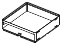
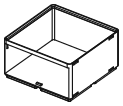
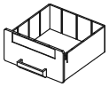
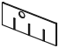

<!-- Generated by `uv run stakee-build`. Edit the generator, not this file. -->

# Drawer cabinet

Stackable sleeves with an open front and the drawers that slide into them.

[All models](../README.md) · 8 parts · rebuild with `uv run stakee-build --only drawers` · source: [`stakee/modules/drawers.py`](../../stakee/modules/drawers.py)

## Parts

| Preview | Part | Size (mm) | Material | Download |
| --- | --- | --- | --- | --- |
|  | **Drawer sleeve 2x2x3** Crate shell with an open front: same feet, lip and clip sockets as a crate, so sleeves stack into a cabinet and take a crate or a cap on top. Holds one drawer. | 83.5 × 83.5 × 25 | PLA or PETG | [STL](stl/sleeve-2x2x3.stl) · [STEP](step/sleeve-2x2x3.step) |
|  | **Drawer 2x2x3** Drawer for the 2x2x3 sleeve, inside 75.6 x 79.4 x 11.0 mm, divider slots every 21 mm, label recess and finger cup on the front. Slides out 54 mm to a stop; lift the front to take it out. | 83 × 90.4 × 20.5 | PETG (the detent tongues flex) or PLA | [STL](stl/drawer-2x2x3.stl) · [STEP](step/drawer-2x2x3.step) |
|  | **X rail for drawer 2x2x3** Divider rail sized for the 2x2x3 drawer, 9.0 mm tall, notched from below; goes in after the Y rail. Same profile as the crate rails. | 76.8 × 1.5 × 9 | PLA | [STL](stl/rail-x-drawer-2x2x3.stl) · [STEP](step/rail-x-drawer-2x2x3.step) |
|  | **Y rail for drawer 2x2x3** Divider rail sized for the 2x2x3 drawer, 9.0 mm tall, notched from the top; goes in first. Same profile as the crate rails. | 80.6 × 1.5 × 9 | PLA | [STL](stl/rail-y-drawer-2x2x3.stl) · [STEP](step/rail-y-drawer-2x2x3.step) |
|  | **Drawer sleeve 2x2x6** Crate shell with an open front: same feet, lip and clip sockets as a crate, so sleeves stack into a cabinet and take a crate or a cap on top. Holds one drawer. | 83.5 × 83.5 × 46 | PLA or PETG | [STL](stl/sleeve-2x2x6.stl) · [STEP](step/sleeve-2x2x6.step) |
|  | **Drawer 2x2x6** Drawer for the 2x2x6 sleeve, inside 75.6 x 79.4 x 32.0 mm, divider slots every 21 mm, label recess and finger cup on the front. Slides out 54 mm to a stop; lift the front to take it out. | 83 × 90.4 × 41.5 | PETG (the detent tongues flex) or PLA | [STL](stl/drawer-2x2x6.stl) · [STEP](step/drawer-2x2x6.step) |
|  | **X rail for drawer 2x2x6** Divider rail sized for the 2x2x6 drawer, 30.0 mm tall, notched from below; goes in after the Y rail. Same profile as the crate rails. | 76.8 × 1.5 × 30 | PLA | [STL](stl/rail-x-drawer-2x2x6.stl) · [STEP](step/rail-x-drawer-2x2x6.step) |
|  | **Y rail for drawer 2x2x6** Divider rail sized for the 2x2x6 drawer, 30.0 mm tall, notched from the top; goes in first. Same profile as the crate rails. | 80.6 × 1.5 × 30 | PLA | [STL](stl/rail-y-drawer-2x2x6.stl) · [STEP](step/rail-y-drawer-2x2x6.step) |

## Print notes

- **Drawer sleeve 2x2x3, Drawer sleeve 2x2x6**: Upright on its feet, no supports. The lintel over the opening bridges 79.5 mm: print a bridge test first and keep part cooling at 100% for bridges. 3 walls, 15% infill. Optional 6x2 mm magnets.
- **Drawer 2x2x3, Drawer 2x2x6**: Upright on its floor, no supports: the groove under the floor bridges 7.6 mm, the finger cup grows at 45 deg. 4 walls (the walls are 1.6 mm), 15% infill.
- **X rail for drawer 2x2x3, Y rail for drawer 2x2x3, X rail for drawer 2x2x6, Y rail for drawer 2x2x6**: Flat on the bed (the thick-end side up), no supports, 100% infill.

## How it works

Drawer cabinet: stackable sleeves with an open front, and the drawers that slide into them.

A sleeve keeps the whole crate contract (core feet underneath, core lip pocket on top, clip
sockets on the sides), so sleeves stack on each other at exactly 7 * h, sit on Gridfinity
baseplates and on any crate of the same footprint, and take a crate or a cap on top. Its front
wall is cut away below a lintel; a stack of sleeves is the cabinet.

Frames: a sleeve is centered on XY with its feet on z = 0 (front face -Y). A drawer is exported
in the frame of its sleeve, lowered by FLOOR_Z: placed at (0, 0, FLOOR_Z) it is closed.

Mechanism, all in the printed geometry (no hardware):
- Closing stop: the front plate is wider and taller than the opening; its back face lands on
  the sleeve's front face (side walls and lintel). The tray keeps BACK_CLEARANCE to the back.
- Retention stop: a 1 mm block on the sleeve floor, just behind the front wall, runs in a
  groove under the drawer floor. A catch in the groove meets it after TRAVEL mm. The catch is
  rigid: lift the drawer front (it tilts about its back edge, the lintel leaves TOP_CLEARANCE)
  and the catch rises over the block, so the drawer comes out; pushing it back in, the 45 deg
  ramp behind the catch lifts it the same way.
- Closed detent: two tongues cut free in the drawer side walls carry 45 deg bumps that click
  into vertical dimples in the sleeve walls when the drawer is closed. They only rub for the
  first few mm of travel, then leave the sleeve.

Print: sleeves upright on their feet; the lintel is the only bridge (as wide as the cavity).
Drawers upright on their floor; the groove under the floor bridges GROOVE_WIDTH. No supports.
