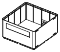
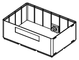

<!-- Generated by `uv run stakee-build`. Edit the generator, not this file. -->

# ESD crates

Crates with a ground point (banana socket or snap stud) for dissipative filament.

[All models](../README.md) · 3 parts · rebuild with `uv run stakee-build --only esd` · source: [`stakee/modules/esd.py`](../../stakee/modules/esd.py)

## Parts

| Preview | Part | Size (mm) | Material | Download |
| --- | --- | --- | --- | --- |
|  | **ESD crate 2x2x3** Stakee crate (80x80x16 mm cavity) for static-dissipative filament, with a ground point in the back wall for a 4 mm banana socket or a 10 mm snap stud, so it bonds to your ESD mat ground. Stacked crates do not ground each other: lead each one, or chain the jacks. | 83.5 × 83.5 × 25 | Static-dissipative filament (PETG-ESD / ABS-ESD sold as 1e6-1e9 ohm surface resistance; aim for 1e5-1e9 ohm/sq). Conductive PLA (~1e1-1e4 ohm*cm, e.g. Protopasta 30-115) also works but is too conductive for powered boards: it can short pins and discharges a charged part fast. Plain PLA/PETG is an insulator and does nothing here. | [STL](stl/esd-crate-2x2x3.stl) · [STEP](step/esd-crate-2x2x3.step) |
|  | **ESD crate 2x2x6** Stakee crate (80x80x36 mm cavity) for static-dissipative filament, with a ground point in the back wall for a 4 mm banana socket or a 10 mm snap stud, so it bonds to your ESD mat ground. Stacked crates do not ground each other: lead each one, or chain the jacks. | 83.5 × 83.5 × 46 | Static-dissipative filament (PETG-ESD / ABS-ESD sold as 1e6-1e9 ohm surface resistance; aim for 1e5-1e9 ohm/sq). Conductive PLA (~1e1-1e4 ohm*cm, e.g. Protopasta 30-115) also works but is too conductive for powered boards: it can short pins and discharges a charged part fast. Plain PLA/PETG is an insulator and does nothing here. | [STL](stl/esd-crate-2x2x6.stl) · [STEP](step/esd-crate-2x2x6.step) |
|  | **ESD crate 3x2x6** Stakee crate (122x80x36 mm cavity) for static-dissipative filament, with a ground point in the back wall for a 4 mm banana socket or a 10 mm snap stud, so it bonds to your ESD mat ground. Stacked crates do not ground each other: lead each one, or chain the jacks. | 125.5 × 83.5 × 46 | Static-dissipative filament (PETG-ESD / ABS-ESD sold as 1e6-1e9 ohm surface resistance; aim for 1e5-1e9 ohm/sq). Conductive PLA (~1e1-1e4 ohm*cm, e.g. Protopasta 30-115) also works but is too conductive for powered boards: it can short pins and discharges a charged part fast. Plain PLA/PETG is an insulator and does nothing here. | [STL](stl/esd-crate-3x2x6.stl) · [STEP](step/esd-crate-3x2x6.step) |

## Print notes

- **ESD crate 2x2x3, ESD crate 2x2x6, ESD crate 3x2x6**: Upright, no supports: the hole has a 45 deg teardrop roof and the hex pocket a 6 mm flat bridge. Hardened nozzle (carbon-filled filaments are abrasive); 4+ walls and 40%+ infill so the body conducts well. Ground point: M6 4 mm banana socket (collar outside, 10 mm nut in the pocket; 3 mm clamped wall, needs >= 7 mm of thread) or 10 mm male snap stud on an M3/M4 screw with washer + nut in the pocket. A toothed lock washer under the outer collar bites through the printed skin. Ground it through a 1 Mohm cord (mat/common-point cord or the bench ground point), never straight to mains earth. Check it: meter between the stud and the inside floor or a far corner; dissipative parts read 1e5-1e9 ohm, above ~40 Mohm a multimeter is blind and you need a 10/100 V megohmmeter. Printed crates are not certified ESD packaging; resistance drifts with humidity, layer direction and wear.

## How it works

ESD crates: the standard Stakee crate with a ground point, for static-dissipative filament.

The ground point is a 6.5 mm through hole in the back (+Y) wall, backed by a pad on the inside
that makes the wall 6 mm thick there and carries a flat-top hex pocket for the nut. It takes
either hardware option, both of which clamp metal against the printed wall from both sides:

- a 4 mm banana socket with an M6 threaded body (the common panel-mount type, e.g. Electro-PJP
  3240 / 3115: M6 stud, 10 mm A/F nut): collar outside, nut captive in the hex pocket, so it
  tightens from outside with a spanner on the collar. Sockets made for an 8 mm hole (e.g. PJP
  3230) fit after drilling the hole out to 8 mm; their nut then bears on the pad face.
- a 10 mm male snap stud (the ESD wrist-strap / mat-cord snap) with a screw post or centre
  hole: M3 or M4 screw through the hole, DIN 125 washer (9 mm OD) + nut in the hex pocket.

Location: centre x = GRID / 4 (10.5 mm), midway between the divider slots at x = 0 and 21 for
every footprint width, hole centre 12.75 mm above the bottom. That keeps the 18 mm pad 0.9 mm
clear of both neighbouring divider plates, below the stacking seat (pad top 20.0 mm vs seat
>= 21.0 mm), and the 14 mm outside clamp face away from clip sockets (+/-X) and label (-Y).

Stacked crates touch only through the feet resting in the lip. Printed-surface to
printed-surface contact resistance is high and unpredictable, so do not count on a stack
grounding itself: give every crate its own lead, or chain the jacks with banana leads.
