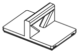
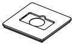

<!-- Generated by `uv run stakee-build`. Edit the generator, not this file. -->

# Carry kit

Stack clip, tote handle cap, NFC label cap and tool-rack cap for a grab-and-go stack.

[All models](../README.md) · 6 parts · rebuild with `uv run stakee-build --only kit` · source: [`stakee/modules/kit.py`](../../stakee/modules/kit.py)

## Parts

| Preview | Part | Size (mm) | Material | Download |
| --- | --- | --- | --- | --- |
|  | **Stack clip** Bayonet clip that locks two stacked crates (or a crate and a handle cap) together at the seam, so the stack lifts as one and the clip cannot be pulled straight off. Fits every box height. | 5.9 × 14 × 16.6 | PETG (PLA is too brittle for the hooks and detent finger) | [STL](stl/stack-clip.stl) · [STEP](step/stack-clip.step) |
|  | **Tote handle cap 2x2** Cap with a carry handle and clip sockets: clip it to the top crate and the whole stack becomes a grab-and-go tote. | 83.5 × 83.5 × 50 | PETG | [STL](stl/tote-cap-2x2.stl) · [STEP](step/tote-cap-2x2.step) |
|  | **Tote handle cap 3x2** Cap with a carry handle and clip sockets: clip it to the top crate and the whole stack becomes a grab-and-go tote. | 125.5 × 83.5 × 50 | PETG | [STL](stl/tote-cap-3x2.stl) · [STEP](step/tote-cap-3x2.step) |
|  | **NFC label cap 2x2** Lid hiding a 25 mm NTAG215 under a swappable label tile: tap a phone to open the box's inventory page. | 83.5 × 83.5 × 7.2 | PETG or PLA | [STL](stl/nfc-cap-2x2.stl) · [STEP](step/nfc-cap-2x2.step) |
|  | **NFC label tile** Snap-in label tile with embossed text; covers the NFC tag in the NFC cap. | 53 × 30 × 2.2 | PLA or PETG, two colours | [STL](stl/nfc-label-tile.stl) · [STEP](step/nfc-label-tile.step) |
|  | **Tool rack cap 2x2** Cap with a rack for four screwdrivers, flush cutters, wire strippers and three tweezers, so your hand tools ride on top of the stack. | 83.5 × 83.5 × 39 | PETG (TPU 95A for a softer, rattle-free rack) | [STL](stl/tool-rack-cap-2x2.stl) · [STEP](step/tool-rack-cap-2x2.step) |

## Print notes

- **Stack clip**: Print on its side, the detent-finger end (opposite the hooks) on the bed, so the hooks grow straight up from their stems; no supports, 100% infill, thin walls / Arachne on (hooks are 0.55 mm). To fit: tab down, push both hooks into the socket windows, slide 5 mm the way the hooks point until the detent clicks. To remove: slide back 5 mm, pull the tab. Two per side, four per seam.
- **Tote handle cap 2x2, Tote handle cap 3x2**: Print on its front face (-Y on the bed): the handle profile then has only vertical walls and 45 deg window sides, and the L clip sockets only bridge 1.6 mm; no supports. 4 walls, 20% infill.
- **NFC label cap 2x2**: Upright, no supports. Stick the NTAG215 in the round pocket, then snap the label tile over it.
- **NFC label tile**: Flat, text up, no supports. Filament swap at z = 1.6 mm for coloured text. Edit the text in make_label_tile().
- **Tool rack cap 2x2**: Upright, no supports (the L clip sockets in the rim only bridge 0.6-1.2 mm). 3 walls, 15% infill.

## How it works

Grab-and-go kit: accessories that turn a stack of crates into a carryable hacker kit.

Parts: a bayonet stack clip that locks two stacked crates together at the seam, a tote handle
cap, an NFC label cap with a swappable snap-in text tile, and a tool rack cap.

Clip geometry is expressed relative to the seam `z = 7 * h_lower` (the stacking pitch):
the lower crate's lip socket sits at `LIP_ABOVE_NOMINAL - CLIP_SOCKET_LIP_Z` = +2.0 mm and
the upper part's base socket at `CLIP_SOCKET_BASE_Z` = +6.5 mm, for every box height.
The sockets are core's L pockets: the clip's L nubs go into the windows, then the clip slides
`CLIP_SOCKET_LEG` along the face so the hooks sit behind the skin.
