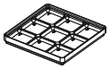

<!-- Generated by `uv run stakee-build`. Edit the generator, not this file. -->

# Magnetic tray

A stackable screw tray with hidden magnets and one numbered compartment per step.

[All models](../README.md) · 2 parts · rebuild with `uv run stakee-build --only magtray` · source: [`stakee/modules/magtray.py`](../../stakee/modules/magtray.py)

## Parts

| Preview | Part | Size (mm) | Material | Download |
| --- | --- | --- | --- | --- |
|  | **Magnetic repair tray 2x2** 9 numbered compartments, one per disassembly step, each with a hidden magnet that grabs M2/M2.5 screws. Seats on any crate as a cap and crates stack on top of it, so a half-done repair can be put away. | 83.5 × 83.5 × 11 | PLA or PETG + 10x2 mm N52 disc magnets | [STL](stl/magtray-2x2.stl) · [STEP](step/magtray-2x2.step) |
|  | **Magnetic repair tray 3x2** 12 numbered compartments, one per disassembly step, each with a hidden magnet that grabs M2/M2.5 screws. Seats on any crate as a cap and crates stack on top of it, so a half-done repair can be put away. | 125.5 × 83.5 × 11 | PLA or PETG + 10x2 mm N52 disc magnets | [STL](stl/magtray-3x2.stl) · [STEP](step/magtray-3x2.step) |

## Print notes

- **Magnetic repair tray 2x2**: Upright (foot on the bed), no supports, 0.2 mm layers including the first. Insert a pause at z = 3.0 mm (before the first layer over the pockets, i.e. after the 2.8 mm layer): drop 9 10x2 mm N52 magnets into the pockets, resume. The 0.6 mm ceiling prints on top of them; magnet polarity does not matter.
- **Magnetic repair tray 3x2**: Upright (foot on the bed), no supports, 0.2 mm layers including the first. Insert a pause at z = 3.0 mm (before the first layer over the pockets, i.e. after the 2.8 mm layer): drop 12 10x2 mm N52 magnets into the pockets, resume. The 0.6 mm ceiling prints on top of them; magnet polarity does not matter.

## How it works

Magnetic repair tray: a 1-unit stackable cap whose top is a numbered screw tray.

Design: the tray side is the top, so it never has to be flipped (a flipped tray would pour
its screws out). The underside is the solid cap foot (same envelope as `make_cap`), so it
seats in any crate's stacking lip at `z = 7 * h`. The rim is a full stacking lip at the
1-unit height (lip top 11 mm, like a `BoxSize(nx, ny, 1)`), so crates and caps stack on
top of it at a 7 mm pitch: put the tray on a crate mid-repair, stack the next crate on it,
and the screws stay put underneath. On the bench it stands on its flat foot.

Each compartment (one per disassembly step, debossed step number in the back-left corner)
has filleted floor edges and one 10x2 mm N52 disc magnet at its center, sealed in by a print
pause under a 0.6 mm ceiling (3 layers at 0.2 mm). Divider tops stop 0.2 mm below the feet
of a crate stacked on top; screws lying flat (M2.5 head <= 2.5 mm) clear those feet.
