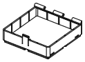
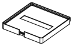
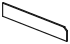

<!-- Generated by `uv run stakee-build`. Edit the generator, not this file. -->

# Pocket box

A small hinged, latched box to carry around that still stacks like a crate.

[All models](../README.md) · 6 parts · rebuild with `uv run stakee-build --only pocket` · source: [`stakee/modules/pocket.py`](../../stakee/modules/pocket.py)

## Parts

| Preview | Part | Size (mm) | Material | Download |
| --- | --- | --- | --- | --- |
|  | **Pocket box base 2x1x4** Carry box with Stakee feet: 16 mm deep inside, three hinge knuckles at the back, a snap tab at the front. Closed with its lid it stacks like a 2x1x4 crate. | 83.5 × 41.5 × 27 | PETG (the latch tab flexes; PLA tabs crack) | [STL](stl/pocket-base-2x1x4.stl) · [STEP](step/pocket-base-2x1x4.step) |
|  | **Pocket box lid 2x1** Hinged lid with two knuckles at the back, a notch the latch clicks into, a full stacking lip on top and a label recess in its floor. | 83.5 × 41.5 × 10.5 | PETG | [STL](stl/pocket-lid-2x1.stl) · [STEP](step/pocket-lid-2x1.step) |
|  | **Pocket box divider 2x1** Plate for the slots at x = 21 mm: a cable bay beside the board. | 38.7 × 1.2 × 15.7 | PLA or PETG | [STL](stl/pocket-divider-2x1.stl) · [STEP](step/pocket-divider-2x1.step) |
|  | **Pocket box base 2x2x4** Carry box with Stakee feet: 16 mm deep inside, three hinge knuckles at the back, a snap tab at the front. Closed with its lid it stacks like a 2x2x4 crate. | 83.5 × 83.5 × 27 | PETG (the latch tab flexes; PLA tabs crack) | [STL](stl/pocket-base-2x2x4.stl) · [STEP](step/pocket-base-2x2x4.step) |
|  | **Pocket box lid 2x2** Hinged lid with two knuckles at the back, a notch the latch clicks into, a full stacking lip on top and a label recess in its floor. | 83.5 × 83.5 × 10.5 | PETG | [STL](stl/pocket-lid-2x2.stl) · [STEP](step/pocket-lid-2x2.step) |
|  | **Pocket box divider 2x2** Plate for the slots at x = 21 mm: a cable bay beside the board. | 80.7 × 1.2 × 15.7 | PLA or PETG | [STL](stl/pocket-divider-2x2.stl) · [STEP](step/pocket-divider-2x2.step) |

## Print notes

- **Pocket box base 2x1x4, Pocket box base 2x2x4**: Upright on its feet, no supports: the knuckles and the back recess are chamfered 45 deg. 4 walls so the 1.6 mm tab is solid perimeters. Optional 6x2 mm magnets.
- **Pocket box lid 2x1, Pocket box lid 2x2**: On its flat underside, no supports (knuckle chamfers 45 deg). Hinge: push a 82.5 mm length of 1.75 mm filament through all five knuckles from one side.
- **Pocket box divider 2x1, Pocket box divider 2x2**: Flat, no supports.

## How it works

Pocket box: a small hinged, latched box you carry, that is still a Stakee box.

Closed, base + lid have the envelope of a `BoxSize(nx, ny, 4)` crate: Gridfinity feet under
the base, a full stacking lip on top of the lid at `7 * h + 4`. So the closed box seats on
any crate's lip at `7 * h_lower` and a crate or cap seats on it at `7 * h`.

Parting plane `z = split`: the base is the core crate cut there; the lid is a solid slab
(printed on its flat underside) with the core lip pocket and a floor `STACK_CLEARANCE` below
the feet of whatever stacks on it.

Hinge (back, along X): a pin hinge for a length of 1.75 mm filament. The axis lies
`KNUCKLE_R` in from the back face and `KNUCKLE_R` above the parting plane, so every knuckle
stays inside the footprint and the lid's knuckles touch the bed. Five knuckles alternate base /
lid / base / lid / base. Behind the axis the lid only keeps material above a 45 deg chord (inside
the knuckle radius, so it turns in place), and the base is recessed behind the axis down to
`RECESS_BELOW_AXIS` under it: a lid point can only swing back into the footprint if it lies
within `KNUCKLE_R / cos(angle / 2)` of the axis, so the recess sets the opening angle; at
about 120 deg the lid's back rests on the recess floor.

Latch (front, center): a cantilever tab grown from the base inside a front pocket, flush with
the front face. Its inward bump clicks into a notch in the lid's front slot; the bump's flat
underside holds the lid shut, its 45 deg top lets the lid push it aside when closing. To open,
pull the tab top toward you by the nail groove (1.1 mm at the bump) and lift.
