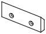

<!-- Generated by `uv run stakee-build`. Edit the generator, not this file. -->

# Wall rail

A French cleat and shelves that hang crates on the wall above the bench.

[All models](../README.md) · 6 parts · rebuild with `uv run stakee-build --only wallrail` · source: [`stakee/modules/wallrail.py`](../../stakee/modules/wallrail.py)

## Parts

| Preview | Part | Size (mm) | Material | Download |
| --- | --- | --- | --- | --- |
|  | **Wall shelf 2x1** Hangs on the wall cleat; its top is a grid of stacking lips, so any 2x1 footprint of crates (or smaller ones, cell by cell) seats exactly as on another crate. Bumper 42 mm below the hook keeps it from tipping forward. | 83.5 × 41.5 × 60.9 | PETG or ASA (load-bearing, PLA creeps) | [STL](stl/shelf-2x1.stl) · [STEP](step/shelf-2x1.step) |
|  | **Wall shelf 2x2** Hangs on the wall cleat; its top is a grid of stacking lips, so any 2x2 footprint of crates (or smaller ones, cell by cell) seats exactly as on another crate. Bumper 52 mm below the hook keeps it from tipping forward. | 83.5 × 83.5 × 71.1 | PETG or ASA (load-bearing, PLA creeps) | [STL](stl/shelf-2x2.stl) · [STEP](step/shelf-2x2.step) |
|  | **Wall shelf 3x2** Hangs on the wall cleat; its top is a grid of stacking lips, so any 3x2 footprint of crates (or smaller ones, cell by cell) seats exactly as on another crate. Bumper 52 mm below the hook keeps it from tipping forward. | 125.5 × 83.5 × 71.1 | PETG or ASA (load-bearing, PLA creeps) | [STL](stl/shelf-3x2.stl) · [STEP](step/shelf-3x2.step) |
|  | **Wall shelf strip 4x1** Hangs on the wall cleat; its top is a grid of stacking lips, so any 4x1 footprint of crates (or smaller ones, cell by cell) seats exactly as on another crate. Bumper 42 mm below the hook keeps it from tipping forward. | 167.5 × 41.5 × 60.9 | PETG or ASA (load-bearing, PLA creeps) | [STL](stl/shelf-4x1.stl) · [STEP](step/shelf-4x1.step) |
|  | **Wall cleat 2 cells** 45 deg French cleat, 83.5 mm long, 2 countersunk holes for 4 mm wood screws on a 42 mm pitch. Butt strips end to end; shelves slide anywhere along it. | 83.5 × 10 × 30 | PETG or ASA | [STL](stl/wall-cleat-2.stl) · [STEP](step/wall-cleat-2.step) |
|  | **Wall cleat 4 cells** 45 deg French cleat, 167.5 mm long, 4 countersunk holes for 4 mm wood screws on a 42 mm pitch. Butt strips end to end; shelves slide anywhere along it. | 167.5 × 10 × 30 | PETG or ASA | [STL](stl/wall-cleat-4.stl) · [STEP](step/wall-cleat-4.step) |

## Print notes

- **Wall shelf 2x1, Wall shelf 2x2, Wall shelf 3x2, Wall shelf strip 4x1**: On its side (an end face on the bed), no supports: the hook, back plate and brace are one constant profile. 4 walls, 25% gyroid. Design load 2 kg.
- **Wall cleat 2 cells, Wall cleat 4 cells**: Front face (the countersunk side) on the bed, bevel facing up, no supports. 4 walls, 30% infill. Use at least 2 screws with wall anchors.

## How it works

Wall rail: crates hang on the wall above the bench on a 45 deg French cleat.

Two parts:
- Wall cleat: a strip screwed to the wall, top bevelled at 45 deg so it falls toward the
  wall (the classic French cleat). 10 mm thick, 30 mm tall at its front face, 20 mm at the
  wall face. 4 mm wood screws on a 42 mm pitch (one per grid cell), 90 deg countersinks
  on the front face. Length is `n * 42 - 0.5` so strips butt end to end on the grid.
- Shelf: a tray whose top is a grid of per-cell stacking lips (core `lip_pocket`, one per
  42 mm cell, like a baseplate), so any crate footprint seats on it exactly as it seats on
  another crate. Behind and below the tray: a hook with the matching 45 deg bevel, a back
  plate, a bumper that rests on the wall, and a diagonal brace up to the tray front.

Side profile (wall frame: `u` = distance from the wall face, `z` = up, 0 = cleat bottom).
The shelf back (tray, hook tip and bumper) is flat at `u = 0`. The hook rests on the cleat
bevel; a 0.5 mm gap separates the back plate from the cleat's front face.

Tipping: the crates' centre of mass sits `d = depth / 2` in front of the wall. The cleat
pushes the hook up and toward the wall with equal components, and the bumper pushes back
at a lever `L` below the cleat contact. Without friction the shelf stays hooked while
`L >= d`; the bumper is placed at `L = 1.25 d` (and always low enough that lifting the
shelf 10 mm to unhook it does not hit the cleat).

Loads (assumed): a full 2x2x6 crate is 0.5-1 kg; design load 2 kg per shelf (two full
crates stacked), PETG, E ~ 2 GPa. At 2 kg the bumper and hook forces are ~16-20 N, spread
over the full shelf width: stresses stay well under 1 MPa, so walls are sized for stiffness,
impact and printability (>= 2.4 mm), not strength. The weak links are the wall screws and
anchors. PETG/ASA rather than PLA because PLA creeps under a sustained load.

Printing: the shelf is a constant side profile extruded across its width, so it prints on
its side (an end face on the bed) with no supports and the bending loads lie in the layer
planes. The only overhangs are the lip pockets' end walls facing up the print: 45 deg
chamfers and a 1.8 mm ledge, bridged across the pocket.
