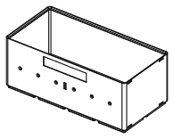
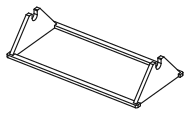
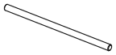

<!-- Generated by `uv run stakee-build`. Edit the generator, not this file. -->

# Wire dispenser

A crate with a lift-out axle and one eyelet per spool for hookup wire.

[All models](../README.md) · 4 parts · rebuild with `uv run stakee-build --only wirespool` · source: [`stakee/modules/wirespool.py`](../../stakee/modules/wirespool.py)

## Parts

| Preview | Part | Size (mm) | Material | Download |
| --- | --- | --- | --- | --- |
|  | **Wire dispenser crate 4x2x9** Holds 6 spools of 52 x 23 mm (hole 12) on a lift-out axle; pull each colour through its own rounded eyelet in the front wall. Pinch slot between the middle eyelets parks a cut end. | 167.5 × 83.5 × 67 | PLA or PETG | [STL](stl/wire-dispenser-4x2x9.stl) · [STEP](step/wire-dispenser-4x2x9.step) |
|  | **Spool cradle frame 4x2x9** Drops onto the dispenser floor: two open-top U-cradles hold the axle so you lift the whole spool set out to swap one. Rails locate it against the end walls. | 162.9 × 78.9 × 35.5 | PETG (PLA ok) | [STL](stl/wire-cradle-frame-4x2x9.stl) · [STEP](step/wire-cradle-frame-4x2x9.step) |
|  | **Spool axle 8 mm** 8 mm rod, 161.5 mm long. Or skip printing: cut an 8 mm steel rod or M8 threaded rod to the same length. | 161.5 × 8 × 7.5 | PETG (stiffer and less creep-prone than PLA under the spool load) | [STL](stl/wire-axle-8mm.stl) · [STEP](step/wire-axle-8mm.step) |
|  | **Spool spacer washer** 18/8.6 x 1.5 mm washer between neighbouring spools so each spins on its own. Print 5. | 18 × 18 × 1.5 | PETG | [STL](stl/wire-spool-washer-8mm.stl) · [STEP](step/wire-spool-washer-8mm.step) |

## Print notes

- **Wire dispenser crate 4x2x9**: Upright, no supports: the eyelet ledge has a 45 deg underside and the 2.6 mm eyelets bridge cleanly. 3 walls, 15% infill. Ream eyelets with a 2.5 mm drill if your printer runs tight. No divider slots on this variant.
- **Spool cradle frame 4x2x9**: Flat on its rails, U-cradles up, no supports. 3 walls, 20% infill.
- **Spool axle 8 mm**: Lying on its 0.5 mm flat along X, no supports, 4 walls, 40% infill; needs a bed at least 165 mm long (print diagonally on smaller beds).
- **Spool spacer washer**: Flat, no supports, 100% infill. Smooth side (bed side) toward a spool.

## How it works

Wire dispenser: a crate that holds hookup-wire spools on an axle, with one eyelet per spool.

Pull the colour you need through its eyelet in the front (-Y) wall; the spools spin
independently on a lift-out axle, so nothing tangles.

Parts: the crate (core box + eyelet ledge + eyelets + optional snip slot), a drop-in cradle
frame with two open-top U-cradles, a printed axle (or an 8 mm steel / M8 threaded rod) and
spacer washers. Everything is parametric in `SpoolSpec`; the footprint and height are
the smallest that fit, so `uv run python -m stakee.modules.wirespool` re-plans the whole
dispenser for your spools once you edit `DEFAULT_SPOOLS`.

Default spools: the common 6-colour 22 AWG kits (TUOFENG, Etokfoks...) ship six 9 m spools
in a ~145 x 55 x 55 mm box, so each spool is about 52 mm across the flanges and 23 mm wide.
Six of those need 158.5 mm of axle span, more than a 3-wide crate's 121.5 mm cavity: the
dispenser is 4x2. A 3x2 dispenser fits six spools up to ~16.7 mm wide (see verify()).
